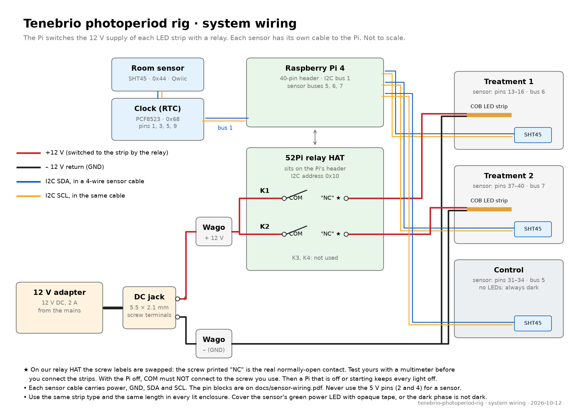

# Tenebrio photoperiod rig

A Raspberry Pi controls the light and dark cycle (photoperiod) of insect enclosures and
records their temperature and humidity. We built it for a zoology master's experiment on
mealworm larvae (*Tenebrio molitor*): two enclosures with different photoperiods and one
dark control. It runs for weeks without a network, and it survives power cuts.

## What it does

- **Switches a 12 V LED strip in each enclosure** on a light/dark cycle, for example
  20 hours of light and 4 hours of dark. Each treatment has its own cycle. Cycles do not
  have to be 24 hours long.
- **Records temperature and humidity** in each enclosure and in the room every 5 minutes,
  with one SHT45 sensor each.
- **Keeps a log of every event:** each light switch, power cut, settings change and
  sensor problem.
- **Shows everything on a website** that works on a phone: live values, charts with the
  light periods and events, CSV downloads, and the settings. It is in Spanish and English.
- **Works without internet.** A clock module keeps the time, and the Pi makes its own
  Wi-Fi network for your phone.
- **Keeps experiments apart.** Each experiment has a name. Archiving one stores its data
  read-only and starts the next one, so practice runs never mix with the real data.

## Designed for a valid experiment

- **The light state comes from the clock only.** After a power cut or a restart, every
  light goes back to its scheduled state within a second.
- **No light without a trusted time.** If the Pi cannot trust its clock, it keeps all
  lights off and shows an alert, because a wrong clock would give the wrong photoperiod.
- **The lights are off when the Pi is off.** The relays are wired so that a Pi that is off
  or starting cannot switch a light on.
- **Data survives power cuts.** Every row goes to the SD card at once. A power cut is
  recorded with its start and end.
- **Heat and light leaks are your job.** Use the same strip length in every lit
  enclosure, and cover the sensors' green power LEDs. The [wiring guide](docs/wiring.md)
  explains both.

## Build it

1. Buy the parts: [bill of materials](docs/bill-of-materials.md). They cost about €250
   (Spain, 2026), plus the four sensors and the enclosures.
2. Install the software: [setup guide](docs/setup-guide.md).
3. Connect the hardware: [wiring guide](docs/wiring.md).
4. Run the experiment: [using the website](docs/using-the-website.md).

## Repository map

| Path | Contents |
|------|----------|
| `lights/` | All the software: light control (`tenebrio_lights.py`), logger (`tenebrio_logger.py`), website (`tenebrio_web.py`, `web/`), network service (`tenebrio_network.py`), systemd services, `deploy.sh` and tests. [lights/README.md](lights/README.md) has the technical details. |
| `lights/config.yaml` | The schedule template: experiment name, start, and each treatment's light and dark hours |
| `docs/` | Bill of materials, guides and wiring drawings (PDF and PNG) |
| `tools/` | The Python scripts that draw the wiring drawings |

## Requirements

- Raspberry Pi 4 with Raspberry Pi OS Lite (64-bit, Debian 13 "trixie")
- Python 3 with `python3-yaml` and `python3-smbus2`, from the system packages
- No other libraries. The website draws its charts itself, because the hotspot has no
  internet.

## License

MIT. See [LICENSE](LICENSE).
