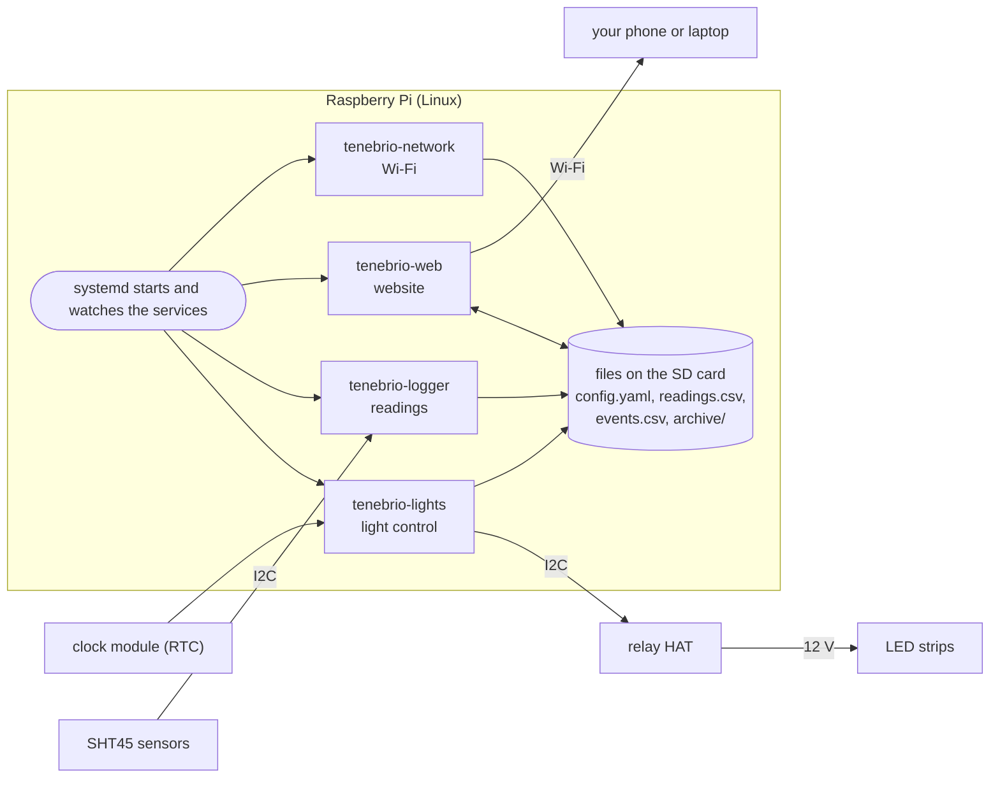

# How the rig works

This page explains the whole system in plain words. You do not need to know programming.
After reading it, you should be able to say what each part does and how the parts work
together. Each section ends with links, if you want to learn more.

## The hardware in one paragraph

A **Raspberry Pi** is a small, complete computer on one board. It has a processor, memory,
Wi-Fi and a row of 40 pins (the **GPIO header**) that connect it to electronics. The rig
adds four kinds of parts to it: a **relay board** that switches the 12 V supply of the
LED strips on and off, **SHT45 sensors** that measure temperature and humidity, a **clock
module** that keeps the time with a coin cell, and the **LED strips** themselves.

Learn more: [Raspberry Pi getting started](https://www.raspberrypi.com/documentation/computers/getting-started.html) ·
[the 40-pin header, pin by pin](https://pinout.xyz/) ·
[what a relay is](https://en.wikipedia.org/wiki/Relay) ·
[SHT45 sensor](https://sensirion.com/products/catalog/SHT45)

## The operating system

The Pi runs **Raspberry Pi OS**, a version of **Linux**. An operating system is the
basic software that runs the computer: it starts the programs, gives them the processor
and memory, and lets them use the files, the network and the pins. Raspberry Pi OS lives
on the microSD card, like Windows lives on a laptop's disk.

The rig uses the "Lite" version, which has no desktop. You control the Pi from your
computer with **SSH**, a secure way to type commands on another computer over the network.

Learn more: [what an operating system is](https://en.wikipedia.org/wiki/Operating_system) ·
[Raspberry Pi OS](https://www.raspberrypi.com/documentation/computers/os.html) ·
[remote access with SSH](https://www.raspberrypi.com/documentation/computers/remote-access.html)

## The programs: Python scripts

The rig's own software is four programs written in **Python**, a programming language
that is popular in science. A Python program is a text file (for example
`tenebrio_lights.py`). The Python interpreter reads the file and does what it says.

Each of the four programs does one job, and each runs **forever in a loop**: it does its
job, waits a little, and does it again. They never stop by themselves.

| Program | Its job | How often |
|---------|---------|-----------|
| `tenebrio_lights.py` | Calculates from the clock and the schedule whether each light should be on, and switches the relays | 4 times per second |
| `tenebrio_logger.py` | Reads every sensor and adds one row to the readings file | Every 5 minutes, at :00, :05, :10… |
| `tenebrio_web.py` | Answers the browser when someone opens the website | When a request arrives |
| `tenebrio_network.py` | Checks the Wi-Fi: home Wi-Fi if possible, else the Pi's own hotspot | Every 30 seconds |

Why four programs and not one? If one program has a problem, the others keep working. For
example, a broken sensor cable can slow down the logger, but it can never delay a light
switch.

Learn more: [the Python tutorial](https://docs.python.org/3/tutorial/)

## Services: who starts the programs

A **service** is a program that runs in the background, without a window and without a
person starting it. (Linux people also call it a *daemon*.) On the Pi, a program called
**systemd** manages the services. Each service is described in a small text file, for
example `tenebrio-lights.service`, which says:

- which Python program to run, and with which files
- which user runs it
- to start it **when the Pi boots**
- to **start it again** a few seconds after it stops, for whatever reason

So nobody needs to start anything. You plug in the Pi, Linux starts, systemd starts the
four services, and the services start their loops. This is also why the rig recovers
after a power cut without help.

Useful commands on the Pi:

    systemctl status tenebrio-lights     # is the service running?
    sudo systemctl restart tenebrio-web  # stop it and start it again
    journalctl -u tenebrio-logger        # the messages it printed

Learn more: [daemons](https://en.wikipedia.org/wiki/Daemon_(computing)) ·
[systemd, introduction](https://wiki.archlinux.org/title/Systemd) ·
[service files, reference](https://www.freedesktop.org/software/systemd/man/latest/systemd.service.html)

## Talking to the electronics: I2C

The Pi talks to the relay board, the clock and the sensors over **I2C** (say
"I-squared-C"). I2C is a simple way for chips to exchange data over two wires: **SDA**
carries the data and **SCL** carries the clock signal that sets the pace. Two more wires
carry power and ground, so every sensor cable has four wires. The small connectors on the
sensors are called **Qwiic** (or STEMMA QT).

Many devices can share one I2C **bus** (one pair of wires). Each device has an
**address**, a number like `0x44`, and the Pi calls a device by its address. All SHT45
sensors have the same address, so two of them cannot share a bus. That is why each
enclosure sensor has its own bus (buses 5, 6 and 7), and the room sensor shares bus 1
with the clock and the relay board.

| Device | Bus | Address |
|--------|-----|---------|
| Relay board | 1 | 0x10 |
| Clock module | 1 | 0x68 |
| Room sensor | 1 | 0x44 |
| Treatment 1 sensor | 6 | 0x44 |
| Control sensor | 5 | 0x44 |
| Treatment 2 sensor | 7 | 0x44 |

Learn more: [I2C tutorial (SparkFun)](https://learn.sparkfun.com/tutorials/i2c/all) ·
[Qwiic connectors](https://www.sparkfun.com/qwiic) ·
[GPIO pins](https://en.wikipedia.org/wiki/General-purpose_input/output)

## Time: why the clock matters

The schedule says, for example, "light from 08:00 for 20 hours". So the rig must know the
correct time, even in a lab with no internet and after a power cut. It has two sources:

- **NTP** (Network Time Protocol): with internet, Linux asks time servers for the exact
  time.
- **The clock module (RTC, real-time clock):** a small chip with its own crystal and a
  coin cell. It keeps counting when the Pi is off. At boot, Linux reads the time from it.

The light program trusts the time only from one of these sources. If it cannot trust the
time, it keeps every light off and the website shows an alert. A light at the wrong time
would spoil the photoperiod.

The light program does not remember anything between runs. Every quarter second, it
calculates the correct state of each light from the time and the schedule. After a crash
or a power cut, it is right again within a second.

Learn more: [real-time clock](https://en.wikipedia.org/wiki/Real-time_clock) ·
[NTP](https://en.wikipedia.org/wiki/Network_Time_Protocol)

## Files: settings and data

Everything the rig knows is in ordinary text files on the SD card, in the folder
`/var/lib/tenebrio-lights/`. The programs themselves are in `/opt/tenebrio-lights/`.

| File | Contents | Written by |
|------|----------|------------|
| `config.yaml` | The settings: experiment name, start, light and dark hours per treatment | The website (Settings page) |
| `readings.csv` | One row every 5 minutes: temperature and humidity of each sensor | Logger |
| `events.csv` | One row per event: light switch, power cut, settings change… | All four programs |
| `archive/<name>/` | The files of each finished experiment, read-only | The website (archive button) |

- **YAML** is a format for settings that people can read and edit.
- **CSV** (comma-separated values) is a table as text: one line per row, commas between
  columns. Excel, LibreOffice, R and Python all open it.

The light program checks `config.yaml` four times per second. When you save new settings
on the website, the lights follow them within a second. Every row is written to the SD
card at once, so a power cut loses almost nothing.

Learn more: [YAML](https://yaml.org/) ·
[CSV](https://en.wikipedia.org/wiki/Comma-separated_values)

## The website

`tenebrio_web.py` is a small **web server**: a program that waits for browsers to ask for
pages and sends them back. Your phone and the Pi talk **HTTP**, the language of the web.

1. You open `http://10.42.0.1` (or `http://tenebrio.local`). The browser asks the Pi for
   the page.
2. The web server sends the page: **HTML** (the content), **CSS** (the look) and
   **JavaScript** (a program that runs in your browser).
3. The JavaScript asks the server for the latest values every 15 seconds, and for the
   chart data every minute. The server reads the files and answers in **JSON**, a text
   format for data.
4. The JavaScript draws the charts in your browser (as **SVG** pictures). It needs no
   internet, which is important in the lab.

When you save settings, the browser sends them to the server. The server checks them,
writes `config.yaml` and adds a row to `events.csv`. Changes need the settings password.

Learn more: [how HTTP works (MDN)](https://developer.mozilla.org/en-US/docs/Web/HTTP/Overview) ·
[JavaScript (MDN)](https://developer.mozilla.org/en-US/docs/Web/JavaScript) ·
[JSON](https://www.json.org/json-en.html) ·
[SVG (MDN)](https://developer.mozilla.org/en-US/docs/Web/SVG)

## Wi-Fi: home network or hotspot

The Pi has one Wi-Fi radio. It can join a network, or it can be a network (a
**hotspot**, or *access point*). **NetworkManager**, part of Linux, does the actual Wi-Fi
work. `tenebrio_network.py` decides which mode to use:

- At home, it joins your Wi-Fi. You reach the website at `http://tenebrio.local`, and the
  Pi gets the time from the internet.
- In the lab, there is no Wi-Fi it knows, so it starts the hotspot `tenebrio`. Your phone
  joins it and opens `http://10.42.0.1`.

Learn more: [wireless access point](https://en.wikipedia.org/wiki/Wireless_access_point) ·
[NetworkManager](https://networkmanager.dev/)

## Installing and updating: deploy.sh

`deploy.sh` is a **shell script**: a list of commands that runs on your computer. It uses
SSH to copy the programs to the Pi, install the four service files, and restart the
services. You run it once to install, and again after every change to the code.

Learn more: [SSH](https://en.wikipedia.org/wiki/Secure_Shell)

## One day in the life of the rig

| When | What happens |
|------|--------------|
| Power on | Linux starts. It reads the time from the clock module. systemd starts the four services |
| Within 1 second | The light program trusts the time, calculates each light's state and sets the relays. It logs `clock trusted` and `set` |
| Within 1 minute | The network program joins Wi-Fi or starts the hotspot. The logger notices if the last reading was long ago and records a power cut |
| Every 5 minutes | The logger reads the four sensors and adds a row to `readings.csv` |
| At a switch time | The light program switches the relay and adds a row to `events.csv` |
| You open the website | The web server reads the files and your browser draws the charts |
| Power cut | Everything stops. The lights go off, because the relays need the Pi. At the next power-on, the day starts again from the top |
