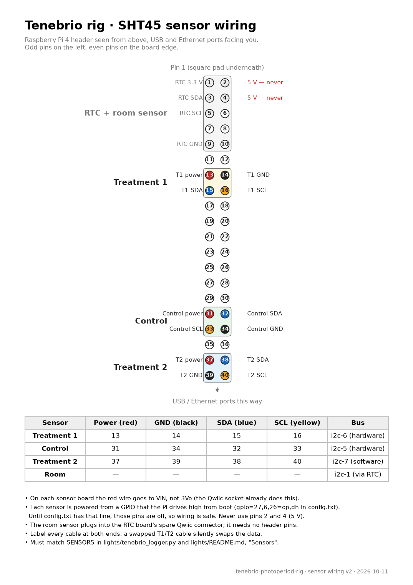

# Wiring

The Pi controls the light with a relay on each lit enclosure's 12 V supply. Each sensor
has its own 4-wire cable to the Pi. Two drawings show the details:

- [system-wiring.pdf](system-wiring.pdf): the whole rig (above).
- [sensor-wiring.pdf](sensor-wiring.pdf): which header pin each sensor wire goes to.

**Work with everything unplugged.** Unplug the Pi's USB-C cable and the 12 V adapter
before you connect or disconnect anything.

## 1. Relay HAT

Push the relay HAT onto the Pi's 40-pin header. The header pins come up through the HAT,
so the other connections in this guide go on top of it.

## 2. Clock (RTC)

1. Put the CR1220 coin cell in the clock board.
2. Use a Qwiic-to-Dupont cable. Connect it to these header pins:

   | Wire | Signal | Pin |
   |------|--------|-----|
   | red | 3.3 V | 1 |
   | blue | SDA | 3 |
   | yellow | SCL | 5 |
   | black | GND | 9 |

## 3. Room sensor

Connect the room sensor to the clock board's second Qwiic socket with a Qwiic-to-Qwiic
cable. It needs no header pins. Place it where it measures the room, away from the Pi and
the LED strips.

## 4. Enclosure sensors

Each enclosure sensor uses a block of four neighbouring pins. Use a Qwiic-to-Dupont cable,
and Dupont extensions if you need more length. Our cables were about 1 m long and worked
without errors.

| Sensor | Power (red) | GND (black) | SDA (blue) | SCL (yellow) |
|--------|-------------|-------------|------------|--------------|
| Treatment 1 | 13 | 14 | 15 | 16 |
| Control | 31 | 34 | 32 | 33 |
| Treatment 2 | 37 | 39 | 38 | 40 |

- The power pins are normal GPIO pins. The Pi switches them on at boot, after you add the
  `gpio=` line in the [setup guide](setup-guide.md). A sensor needs only a few mA.
- **Never connect a sensor to pin 2 or 4.** They carry 5 V.
- **Label both ends of every cable.** If you swap the treatment 1 and treatment 2 cables,
  the data is swapped and nothing warns you.
- **Cover the green power LED on each sensor with opaque tape.** Otherwise the dark
  enclosures are not dark.

## 5. Light circuit

1. Connect the 12 V adapter plug to the DC jack with screw terminals.
2. From the jack, take the **+** wire to a Wago connector. From that connector, run one
   red wire to the **COM** screw of relay K1 and one to relay K2.
3. Take the jack's **–** wire to a second Wago connector. The black wire of every strip
   comes back to this connector.
4. **Find the right output screw on each relay before you go on.** Each relay has two
   output screws, labelled NO and NC. On our board the labels were swapped. Test yours:
   - With the Pi off, use the multimeter's continuity test between COM and each output
     screw. The correct screw is the one that does **not** connect to COM.
   - Then start the Pi, stop the light control (`sudo systemctl stop tenebrio-lights`)
     and switch relay 1 on: `sudo i2cset -y 1 0x10 0x01 0xFF`. Now COM must connect to the same
     screw. Switch it off with `sudo i2cset -y 1 0x10 0x01 0x00`, and start the light control
     again (`sudo systemctl start tenebrio-lights`).

   With the correct screw, the lights are off whenever the Pi is off or starting.
5. From the correct output screw of K1, run a red wire to the **+** of treatment 1's strip.
   Do the same from K2 to treatment 2's strip.
6. Connect each strip with a COB strip connector. Match **+** on the strip to the red wire.
   If a strip stays dark, check this first: the + and – are easy to swap.
7. Plug in the 12 V adapter last.

## 6. Check

After the software is installed ([setup guide](setup-guide.md)):

- `sudo i2cdetect -y 1` shows `10` (relay HAT), `44` (room sensor) and `UU` at 68 (clock).
- `sudo i2cdetect -y 5`, `-y 6` and `-y 7` each show `44` (control, treatment 1, treatment 2).
- Breathe on one sensor at a time. Its humidity jumps on the website within 5 minutes.
  This proves the cables are not swapped.
